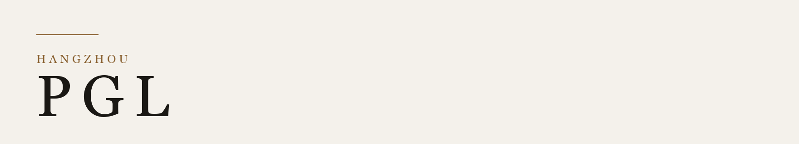

<picture>
  <source media="(prefers-color-scheme: dark)" srcset="./assets/plate-dark.png">
  <source media="(prefers-color-scheme: light)" srcset="./assets/plate-light.png">
  
</picture>

从前端走到全栈。在意一个东西从界面到上线，是不是同一条链路。

[笔记](https://guxiaobiao.com/blog) · [penggelieg@gmail.com](mailto:penggelieg@gmail.com)

### 现在

顺着 Vue 3 和 Vite 把工程链路摸清，用 Docker 和 Kubernetes 把应用跑稳。最近写了 [从零搭建 AI API 中转平台](https://guxiaobiao.com/blog/09-ai-relay-platform)。

### 作品

<table>
  <tr>
    <td width="110"><a href="https://marketplace.visualstudio.com/items?itemName=guxiaobiao.monocommit-ai"><b>MonoCommit</b></a></td>
    <td>读 Diff，写成 Conventional Commits。</td>
  </tr>
  <tr>
    <td><a href="https://github.com/pgl-g/wills-pub"><b>wils</b></a></td>
    <td>把构建产物发布到 CDN。</td>
  </tr>
  <tr>
    <td><a href="https://github.com/pgl-g/json-to-ts"><b>json-to-ts</b></a></td>
    <td>把 JSON 收成 TypeScript。</td>
  </tr>
  <tr>
    <td><a href="https://github.com/pgl-g/pglRequest"><b>pglRequest</b></a></td>
    <td>基于 axios 的请求封装。</td>
  </tr>
</table>

### 常用

| 前端 | 服务端 | 交付 |
| --- | --- | --- |
| JavaScript · TypeScript | Node.js · Nginx | Docker · Kubernetes |
| Vue · React | MySQL · PostgreSQL | Jenkins · Git · Linux |
| Webpack · Sass | Redis · MongoDB | |
